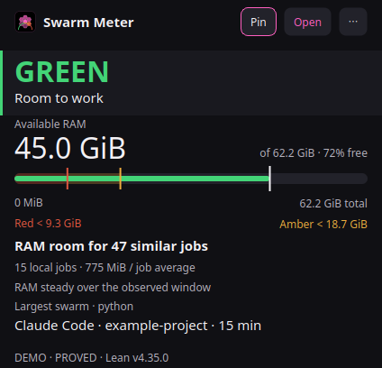
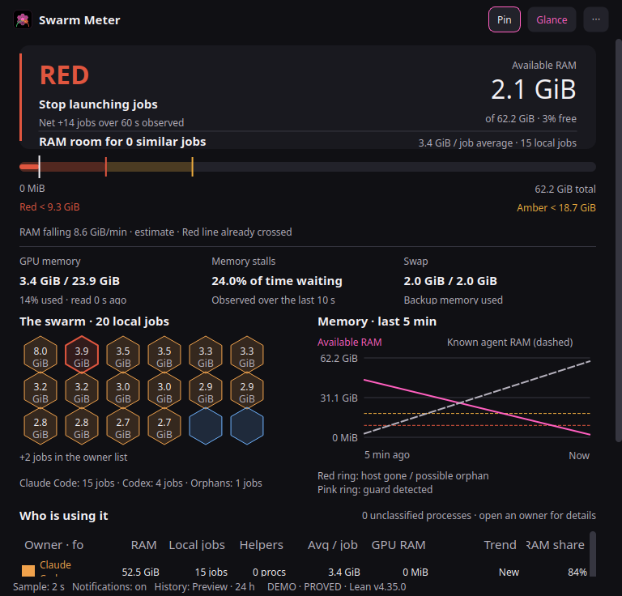

# FUTURE GADGET No.21 — SWARM METER

A Linux desktop monitor for local agent workloads. It shows available memory,
which swarms hold it, and how many more **similar local jobs** fit above a RAM
reserve. A Lean core supplies the risk lamp, threshold lines and job capacity.
The interface stays steady as jobs start and stop.

Daniel directed and orchestrated the project after parallel workloads exhausted
his laptop's RAM. Amadeus (Claude) implemented the original Tk prototype and Lean
core. Astra implemented the PySide6 revision and portability work. This is an
AI-assisted, human-directed project; it is not presented as hand-written work by
Daniel.

## What it looks like





Both captures use the built-in `--demo` fixtures — labelled synthetic values,
not a live machine. The footer reads `DEMO` in these modes.

## Install on your Linux machine

Requirements:

- Python 3.10 or newer with `venv` and `pip` support. Python 3.12 is tested here.
- Lean's `elan` toolchain manager, with `lake` available on `PATH` or in
  `~/.elan/bin`. `core/lean-toolchain` pins the required Lean release.
- A graphical Linux session and the native libraries required by Qt 6 for your
  display backend. Ubuntu X11 is physically tested; other Linux distributions,
  Wayland sessions and CPU architectures need their own runtime verification.
- NVIDIA's existing driver is optional. Without supported NVML telemetry the RAM
  monitor still works and GPU memory is marked unavailable. AMD/Intel GPU memory
  telemetry is not implemented.

From a source checkout, inspect the installation plan, then install:

```bash
python3 install.py --check
python3 install.py
```

The installer creates a private Python environment, installs the pinned packages
from `requirements.txt`, builds the Lean core for the local machine, checks all
six theorem axiom lists, and runs the app's self-tests before registering the
application-menu entry. A new environment needs network access for Python
packages; an existing `elan` installation may fetch the pinned Lean toolchain.
Missing system prerequisites produce an error; the installer never uses `sudo`
or installs drivers or OS packages.

For an additional Desktop icon in your configured, possibly localized Desktop
folder:

```bash
python3 install.py --desktop
```

The application installs under `${XDG_DATA_HOME:-~/.local/share}/swarm-meter`.
To choose another location, use `--install-dir '/your/path/Swarm Meter'`. Paths
with spaces, percent and equals signs are supported. Paths containing control
characters are rejected. A compatible
existing virtual environment can be selected with `--reuse-venv /path/to/venv`;
its packages will not be modified. A conflicting existing `.venv` is never
replaced.

Close Swarm Meter before upgrading. Existing settings/history are kept in place.
Changed files have a dated backup and exact manifest in `install-backups/`.
Failed validation leaves the previous application files and launchers intact;
a failed file-copy transaction restores changed files and retains new files in
the backup. A newly created setup environment may remain for retry. Installation
does not start the application automatically.

## What it detects

- **RAM and swap:** current kernel totals and available memory, sampled each
  interval. Swap size selects the documented reserve policy; Lean applies the
  policy to the detected RAM capacity. No laptop RAM size is used in live mode.
- **Memory pressure:** Linux pressure-stall data when the kernel exposes it.
  Missing required measurements remain unavailable, never a reassuring zero. If Linux memory-pressure data is absent, the decision is UNKNOWN; the app does not invent a pressure-free reading.
- **Processes:** the current user's identity, process parentage, working folders,
  start times, and readable memory. Agent hosts are recognized from process
  evidence rather than fixed installation paths. Private chat/session stores are
  not read.
- **GPU:** installed NVML availability and all detected physical NVIDIA devices. Multiple-card totals sum memory for monitoring; they are not one allocation pool. Unsupported
  devices/drivers are reported honestly. GPU limits are not part of the RAM-only
  “room for similar jobs” estimate.
- **Installation:** the source/install folder, local virtual environment, bundled
  core, current user's XDG data/state locations, and optional Desktop folder.
  Launchers use the installed app instead of the developer's checkout.

New installations keep mutable settings, history, lock and log under
`${XDG_STATE_HOME:-~/.local/state}/swarm-meter`. Existing installations with
`state.json` or `history.db` beside the app keep that location, preserving history
and the single-instance lock. The same discovery applies when launching from the
shell or the desktop.

`SWARM_METER_DATA_DIR` or `--data-dir` isolates mutable data for a test or alternate
profile. `SWARM_METER_CORE` and `SWARM_METER_CORE_DIR` override core discovery;
`SWARM_METER_PYTHON` overrides runtime discovery. Normal launch performs no
package installation or Lean compilation. Standard XDG environment variables
must be absolute paths; otherwise their conventional defaults apply.

## How to read it

1. **Read the light.** GREEN is quiet, AMBER says hold new work, and RED says stop
   launching jobs. Memory stalls can trigger RED even when RAM is available.
2. **Read the bar.** Available RAM and the threshold lines carry MiB/GiB units.
   The white marker is available memory; Lean returns the amber/red lines.
3. **Read capacity for the selected swarm.** Its job count and workload RAM mean
   update with samples. Lean estimates room for more jobs of the same size above
   the red line. Settings can use the largest current job instead of the mean.
   Different swarms share available RAM; their capacity estimates cannot be added.
4. **Open a swarm.** Local jobs, helpers, hosts and unclassified processes have
   separate counts and RAM. Every process remains inspectable with its role
   evidence. The hive shows identifiable local workloads.

The average is workload RAM divided by workload count. Host, helper and
unclassified RAM stays in total owner RAM and machine risk but is excluded from
that average. No identified workload means no observed size or capacity estimate.
A helper may be busy; its role does not assert that it is idle.

A local job is a **process unit, not an exact logical-agent or cloud-task count**.
One agent can launch several workers and several remote tasks can share one host.
Jobs starting and finishing between polls may be missed. Waiting workers still
count; zero CPU usage does not establish that work is finished. Program changes
within the same process can take up to the metadata refresh interval to appear.

Sampling defaults to two seconds, with one/four-second options. Per-process
proportional-memory refreshes have a CPU budget; observed resident-memory growth
is included immediately as a conservative estimate. The inspector reports the
source and age. Forecasts are estimates, and capacity does not predict startup
peaks or guarantee that another workload cannot exhaust RAM or GPU memory.

The optional pink guard marker recognizes the original `sg0-decode` cgroup naming convention; it does not discover every workload manager. Readings describe the Linux host, not container/cgroup memory ceilings.

## Views and controls

The glance view shows risk, headroom and the leading swarm. **Open** reveals the
hive, five-minute graph, RAM/GPU/swap readings, and owner table. Click a workload
or owner for details. **Pin** keeps the window above others. Settings contains
sampling, notifications, capacity basis, machine profile and threshold rationale.
Window position and view persist. There is no idle animation.

The inspector's **TERMINATE** action requires two deliberate clicks within four
seconds, bound to the same Linux process lifetime using a pidfd. It sends only
SIGTERM. Selection changes, exit or expiry cancel the action. Demo/screenshot
processes are inert. There is **no automatic killing**, autostart entry or daemon.

The footer shows history and notification state. History is a local 24-hour
SQLite ring. No telemetry or cloud upload is part of the monitor. The updater is
the user-run installer, not a background service.

## Run and validate

Run `python3 swarm_meter.py --diagnose` from the checkout for a read-only
configuration report, even before Qt is installed.

Launch **Swarm Meter** from the application menu, or run `run.sh` in its installed
folder. From a prepared source checkout with a local `.venv` and built core:

```bash
./run.sh --selftest
./run.sh --demo red --view glance
./run.sh --screenshot /tmp/swarm-red.png --view expanded
./run.sh --screenshot-live /tmp/swarm-live.png --view expanded
```

`--demo` uses labelled synthetic fixtures. Their fixed example hardware values
are illustrations and never substitute for live measurements. CPU/performance
results on one machine are not a promise about every other configuration.

## Architecture and proof boundary

`core/` contains the Lean definitions and six proved theorems: `red_on_time`,
`red_on_pressure`, `green_means_room`, `level_monotone`,
`redLine_le_amberLine`, and `room_sound`. `backend.py` samples the machine,
attributes memory and chooses a swap-based policy; `process_roles.py` classifies
process purposes; `gpu_reader.py` reads the installed driver; `runtime.py` manages
settings, history-facing services and deliberate termination; `ui.py` renders
readings. Entry-point configuration is separate from the views.

Lean proves decisions for the supplied measurements and policy, not the policy's
suitability for every workload. **PROVED** means the core answered successfully;
**FALLBACK** labels the unproved Python replica. Missing required measurements
must not produce a reassuring lamp/capacity. The theorems do not prove that
future workloads are safe or that a computer cannot crash.

## Sharing the project

Only source, test fixtures and original assets belong in a public repository.
The `.gitignore` excludes runtime state/history/logs, environments, build output,
installation backups and measurement outputs. Do not publish a copy of an
installed application directory or private live screenshots/process listings.
The project is licensed under the [MIT License](LICENSE). PySide6 and
shiboken6 are LGPLv3 dependencies installed from PyPI by the user's installer;
they are not bundled in this repository. The application does not create a
GitHub repository or publish anything itself.
